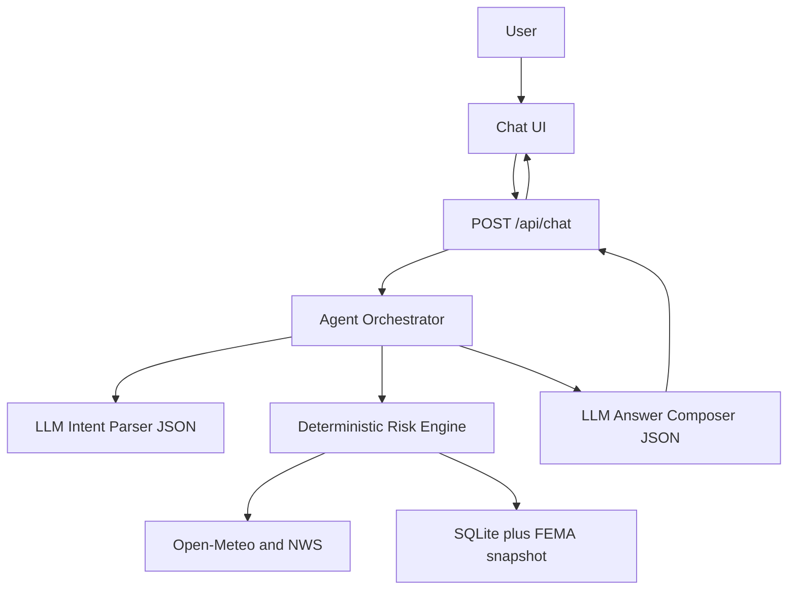

# Design

## Architecture



The model does not rank hubs. Python fetches data, scores it, and checks JSON schema. If the model is missing or fails schema validation twice, the deterministic briefing is returned and the scores still come from Python.

## Components

| Piece | Role |
| --- | --- |
| `backend/app/api/chat.py` | `POST /api/chat` |
| `backend/app/api/hubs.py` | Hub list, one hub score, compare, refresh |
| `backend/app/agent/orchestrator.py` | Session, tool routing, model calls |
| `backend/app/agent/session_context.py` | Intent rules and follow-up memory |
| `backend/app/agent/schemas.py` | Pydantic contracts for intent and answer |
| `backend/app/agent/llm.py` | Schema-checked model calls and the retry |
| `backend/app/agent/composer.py` | Wording built from scores |
| `backend/app/risk/scoring.py` | Formulas below |
| `backend/app/risk/weather.py` | Open-Meteo archive and NWS active alerts |
| `backend/app/risk/hazards.py` | FEMA county snapshot |
| `backend/app/risk/hubs.py` | The ten hubs |
| `frontend/` | Chat. Scores, drivers, assumptions, sources, and follow-ups render inside the answer message. |

Direct score routes exist so the system is not only a chatbot.

## Data

Historical daily weather is the Open-Meteo archive (`temperature_2m_max`, `temperature_2m_min`, `precipitation_sum`, `snowfall_sum`, `wind_gusts_10m_max`), in Fahrenheit, inches, and mph. Snowfall stays in centimeters. No token. This is the reproducible live source. NOAA CDO is not used.

Current alerts are the National Weather Service active alerts for the hub point. Severity weights, which the brief did not specify, are Extreme 3, Severe 2, Moderate 1, Minor 0.5, Unknown 0.25.

FEMA National Risk Index hazard-type scores for the hub counties were queried on 2026-11-23 from the public counties feature service and stored in `backend/data/fema_nri_snapshot.csv`. They are already on a 0–100 scale. A null hurricane or coastal-flood score is stored blank and treated as 0. The flood baseline is the greater of inland and coastal. The severe-storm baseline is the average of tornado, lightning, hail, and strong wind.

The default window is the previous complete calendar year. "Last year" uses that window. Alerts are current, not historical.

Every answer carries `source`, `source_type` (`live_api`, `cached_api`, or `static_public_dataset`), `retrieved_at`, and a short uncertainty note. If a live call fails, an offline climatology stand-in is used and labeled as such. Tests set `WEATHER_DATA_MODE=fixture` so they do not need the network.

## Storage

SQLite holds hubs, the FEMA rows, cached daily observations, cached alerts, score snapshots, chat sessions, messages, and session context. Session context keeps the last hubs, region, hazards, metric, time window, intent, ordered result ids, and the previous user message. That previous turn is sent to the intent parser on the next question. The answer call receives computed scores as read-only input and has no score field in its schema. The response scores are the ones Python computed.

Follow-ups are resolved in Python before tools run. After "Compare Miami and Houston in terms of hurricane and flood exposure", "What about floods only?" stays a comparison of those two hubs with hazards set to flood. "Why is the top one risky?" explains the first hub in the previous ordering. If the reference cannot be resolved, the agent asks one question.

## Scoring

```text
clamp_0_100(x) = min(100, max(0, x))
normalize(value, high) = clamp_0_100((value / high) * 100)
```

Winter:

```text
snow_days_pct = days_with_snowfall_gte_1cm / valid_days * 100
freeze_days_pct = days_with_min_temp_lte_32f / valid_days * 100
winter_alert_score = normalize(winter_alert_weighted_count, 5)

winter_score =
  0.40 * normalize(snow_days_pct, 35) +
  0.30 * normalize(freeze_days_pct, 60) +
  0.20 * winter_baseline_score +
  0.10 * winter_alert_score
```

Flood:

```text
flood_score =
  0.35 * flood_baseline_score +
  0.30 * normalize(heavy_rain_days_pct, 15) +
  0.20 * normalize(very_heavy_rain_days_pct, 5) +
  0.15 * flood_alert_score
```

`heavy_rain_days_pct` is days at or above 1 inch. `very_heavy_rain_days_pct` is days at or above 2 inches. `flood_alert_score = normalize(count, 5)`.

Hurricane:

```text
hurricane_score =
  0.70 * hurricane_baseline_score +
  0.20 * normalize(tropical_alert_weighted_count, 3) +
  0.10 * coastal_modifier
```

`coastal_modifier` is 100 for Miami, Houston, and New York/Newark, otherwise 0. Los Angeles coastal flood stays in the flood baseline. It is not treated as tropical surge.

Heat:

```text
heat_score =
  0.35 * normalize(heat_days_pct, 30) +
  0.25 * normalize(extreme_heat_days_pct, 10) +
  0.25 * heat_baseline_score +
  0.15 * heat_alert_score
```

Heat days are maxima at or above 95 F. Extreme heat days are at or above 100 F. Alert high is 5.

Severe storm:

```text
severe_storm_score =
  0.50 * severe_baseline_score +
  0.30 * severe_alert_score +
  0.20 * normalize(high_wind_days_pct, 10)
```

High-wind days are gusts at or above 40 mph. Alert high is 5.

Overall:

```text
overall_risk =
  0.30 * winter_score +
  0.25 * flood_score +
  0.20 * hurricane_score +
  0.15 * severe_storm_score +
  0.10 * heat_score
```

Midwest winter ranking keeps `region == Midwest` and sorts by `winter_score` descending. A missing input is dropped and the remaining weights are rescaled. A real zero is kept. Each driver has metric name, raw value, weight, contribution, source, freshness, and confidence. Contribution is the effective weight times the normalized value, so contributions sum to the score.

Business-importance weights are stored as 1.0 and are not applied.

## Model boundary

Two schema-checked calls when a key is present:

1. Intent JSON: `rank_hubs`, `compare_hubs`, `metric_lookup`, `explain_hub`, `follow_up`, or `unknown`, plus hubs, region, hazards, metric, window, and a clarification flag.
2. Answer JSON: prose, findings, assumptions, uncertainties, sources, and follow-ups.

Python overwrites `scores` and `sources` after the second call. Explicit hubs and hazards found in the text stay authoritative. One schema retry, then the deterministic answer.

"Safer" means a lower disruption score. With no hubs in context, the agent asks which hubs to compare and states that definition.

## Evaluation

`backend/evals/eval_set.json` checks status, schema, hub names, non-null metrics, assumptions, and sources. There is no model judge. Fixture mode keeps the run offline. One case feeds invalid JSON twice and checks that schema validation fails closed.

## Scope left out

Fixed hubs and five hazards only. No wildfire score, no freight weighting, no history chart, and no hosted deployment. FEMA scores for these urban counties are often saturated; the daily rates are what separate them, and the answers say so.
