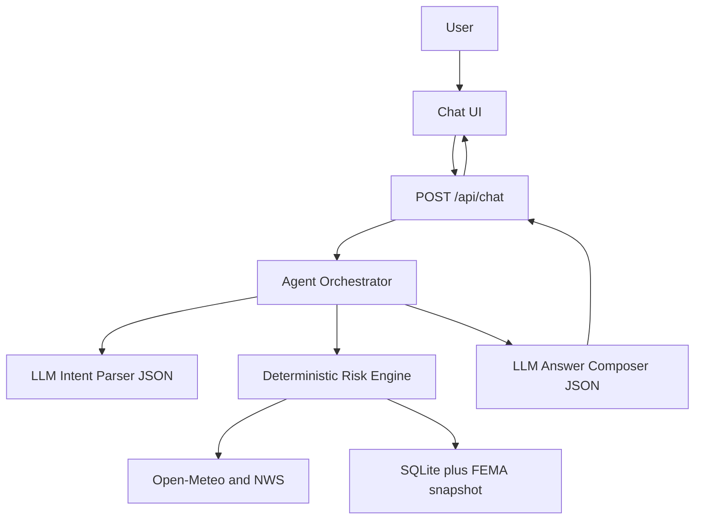

# Design

## System architecture

The system consists of a React frontend and a Python FastAPI backend. The backend orchestrates user requests, retrieves weather and hazard data, calculates deterministic risk scores, and uses an LLM for intent understanding and answer generation. The LLM cannot modify the calculated scores. All model outputs are schema-validated, with a deterministic fallback to ensure reliable responses. SQLite stores cached data, score snapshots, and runtime conversation context.



| Piece | Role |
| --- | --- |
| `frontend/` | React chat. Shows the answer text. A breakdown, assumptions, or the source list appear only when the question asks for them. |
| `backend/app/api/chat.py` | `POST /api/chat`, with a per-IP rate limit |
| `backend/app/api/hubs.py` | Hub list, one hub score, compare, refresh. No model. |
| `backend/app/agent/orchestrator.py` | Coordinates one turn: session, routing, model calls |
| `backend/app/agent/session_context.py` | Intent rules and follow-up memory |
| `backend/app/agent/schemas.py` | Pydantic contracts for intent and answer |
| `backend/app/agent/llm.py` | Schema-checked model calls, one retry |
| `backend/app/agent/composer.py` | Wording skeleton from the scores, then the draft check |
| `backend/app/risk/engine.py` | Loads weather, FEMA, and hubs, then calls the scorer |
| `backend/app/risk/scoring.py` | Deterministic formulas |
| `backend/app/risk/weather.py` | Open-Meteo archive and NWS active alerts |
| `backend/app/risk/hazards.py` | FEMA county snapshot |
| `backend/app/risk/hubs.py` | The ten hubs |
| `backend/app/db/` | SQLite schema and reads/writes |

A chat question crosses these pieces in order. The React UI sends `POST /api/chat` with the text and a `session_id`. `chat.py` checks the rate limit and calls the orchestrator. The orchestrator loads the previous turn from SQLite, and `session_context.py` parses the sentence with rules. An explicit hub or hazard stays as written. When a key is set, `llm.py` asks for an intent JSON, `schemas.py` checks it, and one failure retries before the rules stand. A follow-up such as "What about floods only?" keeps the previous hubs and changes only the hazard. When a score is needed, `engine.py` asks `weather.py`, `hazards.py`, and `hubs.py` for inputs, then `scoring.py` computes the numbers. A saved result comes back from SQLite without a new call. `composer.py` builds a skeleton from those scores. When a key is set, `llm.py` may rephrase it. The answer schema has `answer` and `follow_up_questions` only, and no score field. A number, name, or sentence that was not in the skeleton is rejected, and the user gets the skeleton. The orchestrator then stores the messages, the updated context, and the score snapshot.

`GET /api/hubs`, `GET /api/hubs/{id}/risk`, `GET /api/compare`, and `POST /api/admin/refresh-scores` enter at `hubs.py`. They use the same risk engine and SQLite, and they do not call the orchestrator or the model.

## Repository structure

```text
weather-risk-agent/
├── backend/
│   ├── app/
│   │   ├── api/        FastAPI routes: chat, hubs, rate limit
│   │   ├── agent/      orchestrator, intent rules, composer, model calls, schemas
│   │   ├── risk/       scoring, weather and FEMA clients, hub list
│   │   └── db/         SQLite schema and repository
│   ├── data/           weather_risk.db, FEMA snapshot CSV and metadata
│   ├── tests/          pytest
│   └── evals/          eval_set.json and run_eval.py
├── frontend/src/       Vite + React chat UI, voice input and read-aloud
├── scripts/            setup, dev, test, eval, seed tasks
├── docs/ai-session/    01-plan.md, 02-ui-deploy-iteration.md, 03-code-review.md
├── render.yaml         Render service settings for the API
├── README.md
├── DESIGN.md
└── AI_SESSION.md
```

## Storage

SQLite is a single file with no server to run, and ten hubs plus their cached weather are far below anything that needs a networked database. The committed `backend/data/weather_risk.db` is also what the free Render instance starts with.

The file holds the hubs, the FEMA rows, cached daily observations, cached alerts, and score snapshots. Chat sessions, messages, and session context are written while the app is running and are not kept in the committed file. Session context is the previous hubs, region, hazards, metric, time window, intent, ordered result ids, and the last user message. That previous turn is what a follow-up is resolved against.
